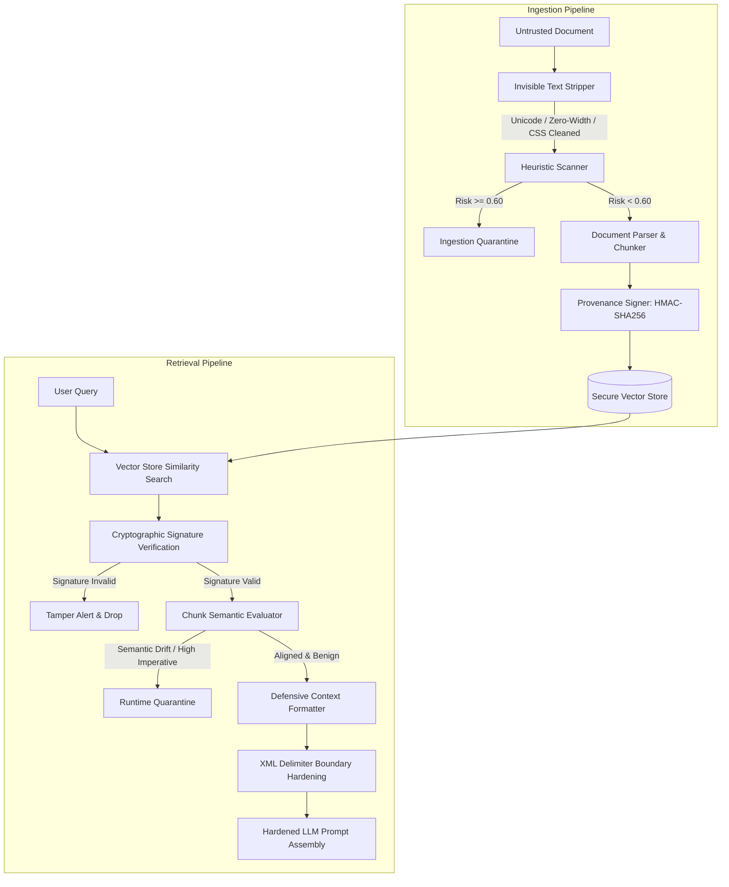

# System Architecture & Defense-in-Depth Pipeline

The RAG Security Poisoning Defense Gateway operates as an inline firewall and sanitization boundary between untrusted documents, external vector stores, and downstream Large Language Models.

